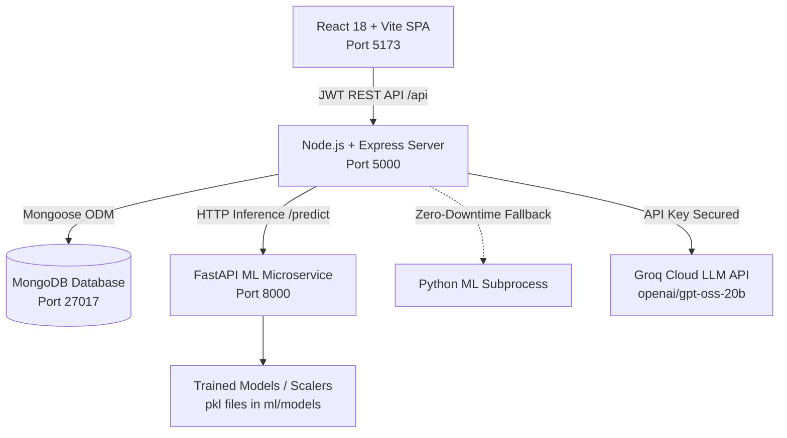

# 🌟 Empyrict-AI — AI-Powered HR & Employee Analytics Platform

> An enterprise-grade, full-stack predictive workforce analytics and employee retention decision-support system. Powered by **Machine Learning (Logistic Regression & Random Forest with Explainability)**, **Groq AI (LLM Reasoning)**, **Node.js/Express**, **MongoDB**, and **React (Vite + Tailwind CSS)**.

---

## 🏗 System Architecture



### 1. Frontend (`client/`)
- **Framework**: React 18, Vite, React Router DOM v6
- **Styling**: Tailwind CSS, PostCSS, Glassmorphism, Dark/Light Mode
- **Charts & Data Viz**: Recharts (Donut, Grouped Bar, Area, Feature Ranking Charts)
- **Icons**: Lucide React
- **HTTP Client**: Axios with JWT Interceptors & Bearer Authentication

### 2. Backend (`server/`)
- **Runtime**: Node.js & Express.js
- **Database**: MongoDB & Mongoose
- **Authentication**: JWT & Bcrypt password hashing
- **Security & Middleware**: Helmet, CORS, Rate Limiting, Centralized Error Handling, Audit Activity Logger
- **AI Integration**: Groq SDK (`openai/gpt-oss-20b`) generating structured 30/60/90-day retention blueprints

### 3. Machine Learning Microservice (`ml/`)
- **Framework**: FastAPI & Uvicorn (`ml/api.py`) + Scikit-Learn
- **Feature Contract**: Standardized ingestion of **30 raw IBM HR workforce parameters** mapped to **44 one-hot encoded features**
- **Explainability**: Quantified directional driver attributions ($w_i \cdot x_i$) for individual risk factor attribution and global feature weights
- **Models**: Calibrated Logistic Regression & Random Forest (`ml/models/`)

---

## 🚀 Quick Start Guide

### Prerequisites
1. **Node.js** (v18+) & **npm**
2. **Python** (3.10+) with active virtual environment (`venv`)
3. **MongoDB** service running locally on `mongodb://localhost:27017`

### 1. Install Dependencies
```bash
# In the root directory:
npm install
npm --prefix server install
npm --prefix client install
```

### 2. Seed Database with Realistic Employee Records
```bash
npm run seed
```
*Seeds default Admin (`admin@empyrict.ai` / `Admin@123`), HR Leader (`hr@empyrict.ai` / `Admin@123`), and 15 monitored employees with pre-computed ML predictions and Groq retention reports.*

### 3. Run All Services Simultaneously
```bash
npm run dev
```
This runs `concurrently` to start:
- **Express Backend**: `http://localhost:5000`
- **React Frontend**: `http://localhost:5173`
- **FastAPI ML API**: `http://localhost:8000`

---

## 🔑 Default Credentials

| Role | Email | Password |
|---|---|---|
| **Platform Administrator** | `admin@empyrict.ai` | `Admin@123` |
| **HR Leader** | `hr@empyrict.ai` | `Admin@123` |

*Or use the one-click demo buttons on the login screen (`/login`).*

---

## 📊 30-Feature Machine Learning Contract

Empyrict-AI evaluates 30 key workforce indicators:
1. **Personal**: `Age`, `Gender`, `MaritalStatus`, `Education`, `EducationField`, `DistanceFromHome`
2. **Role & Department**: `Department`, `JobRole`, `JobLevel`, `BusinessTravel`, `OverTime`, `NumCompaniesWorked`
3. **Tenure**: `YearsAtCompany`, `YearsInCurrentRole`, `YearsSinceLastPromotion`, `YearsWithCurrManager`, `TotalWorkingYears`, `TrainingTimesLastYear`
4. **Compensation**: `MonthlyIncome`, `MonthlyRate`, `DailyRate`, `HourlyRate`, `PercentSalaryHike`, `StockOptionLevel`
5. **Satisfaction**: `JobSatisfaction`, `EnvironmentSatisfaction`, `WorkLifeBalance`, `JobInvolvement`, `RelationshipSatisfaction`, `PerformanceRating`

---

## 🛡 Responsible AI & Ethical Compliance

> **Decision Support Notice**: Machine Learning predictions and Groq AI-generated retention insights serve strictly as advisory decision-support tools for HR leaders. They must **never** be used as the sole basis for adverse employment actions.
